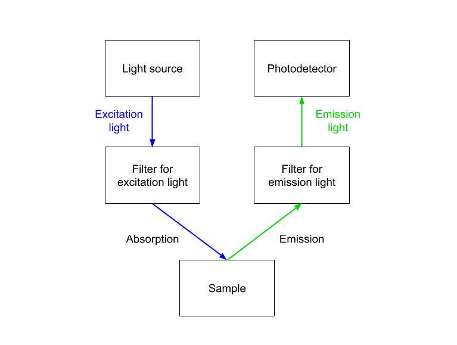

## The Problem

While developing a fluorescence quantification system for a previous employer, we encountered an issue where the measured fluorescence varied significantly from unit to unit. Three instruments in the same production lot measured a **range of 1-3x fluorescence intensity from the same sample**. Repeated measurements with multiple samples confirmed that this difference is consistent and systematic, meaning that (for example) Unit 1 always measures 3x the brightness of Unit 3.

```{python}
#| label: fig-threeunits
#| fig-cap: "Significant unit-to-unit variability between instruments"
#| code-fold: true
#| code-summary: "Click to see code"
import numpy as np
import matplotlib.pyplot as plt

# Electrical parameters
R_sense = 50e-6   # units: Ohms
V_ref = 3.4       # units: Volts
q = 1.6e-19       # units: Coulombs
I = V_ref/R_sense # units: Amps
eta_led = 0.75    
eta_det = 0.5

# Fluorophore parameters
eps = 70000       # units: 1/(M cm)
l = 3             # units: cm
eta_sample = 0.5  # quantum yield

# Optical parameters
eta_opt_ex = 0.2
eta_collected = 0.01
eta_opt_em = 0.4

# Input
c = np.arange(0, 100, 0.5)  # units: nM

# Absorption coefficient
A = eps * c * l * 1e-9

# Fraction of photons absorbed by sample
f_abs = (1 - 10**(-A)) 

# Rate of photons injected into system
N_led = eta_led * V_ref / q / R_sense

# Rate of photons reaching detector (units: 1/sec)
eta_eff = eta_opt_ex * eta_sample * eta_collected * eta_opt_em * eta_det 
N_det = eta_eff * N_led * (1-10**(-A))

plt.plot(c, 1.5 * N_det)
plt.plot(c, N_det)
plt.plot(c, 0.5 * N_det)
plt.plot()
plt.legend(["Unit 1", "Unit 2", "Unit 3"])
plt.xlabel("Fluorophore concentration (nM)")
plt.ylabel("Fluorescence (AU)")
plt.title("Three \"identical\" fluorometers measuring the same sample")
plt.show()
```

As the technical lead for this project, it was my responsibility to make sure that this design was production-ready. I identified possible root causes, designed tests to narrow down the root cause, and took action to prevent this problem from reoccuring in the future.

## System Architecture

First, I revisited the design of the fluorescence system. Below is a high-level description of the architecture and a mathematical model for how the system works.

### Block diagram

Regardless of the specific design, every fluorescence system has the following components connected as shown in @fig-blockdiagram:

- Light source generating light at an excitation wavelength $\lambda_{ex}$
- Photodetector to measure emission light of wavelength $\lambda_{em}$
- Optical components to filter and focus light
- Target sample (outside the instrument) expected to absorb light of wavelength $\lambda_{ex}$ and emit light at a lower wavelength $\lambda_{em}$

{#fig-blockdiagram}

### System model {#sec-systemmodel}

The relationship between fluorophore concentration and the fluorescence reaching the detector is approximately @eq-system-linearized derived in @sec-derivations.
$$
\begin{aligned}
N_{det} &= \eta_{eff} N_{led} \left(1 - 10^{-\epsilon c l}\right) \\
&\approx \eta_{eff} \, \epsilon l \ln 10 \, N_{led} \, c
\end{aligned} 
$$

Assuming the light source is an LED, $N_{led}$ is the rate of excitation photons exiting the LED, $N_{det}$ is the rate of emission photons measured by the detector, $\epsilon$ is a property of the fluorophore, $c$ is the fluorophore concentration, $l$ is the optical path length in the sample, and $\eta_{eff}$ is the effective photoefficiency and the product of multiple efficiency terms:

- $\eta_{opt, ex}$ == optical transmission efficiency for excitation light moving from LED to sample
- $\eta_{sample}$ == quantum yield of the fluorophore at the excitation wavelength
- $\eta_{collected}$ == fraction of emitted fluorescence that's collected by the objective lens
- $\eta_{opt, em}$ == optical transmission efficiency for fluorescence moving from sample to detector
- $\eta_{det}$ == quantum efficiency of the photodetector in converting photons to an electrical signal.

Each instrument can be calibrated such that $N_{led}$ is roughly the same by adjusting the reference voltage $V_{ref}$ (@eq-led), so the fluorescence is mainly dependent on the effective photoefficiency $\eta_{eff}$ and the fluorophore concentration $c$. 

## The Investigation

### Is this variability abnormally high?

Before I started troubleshooting, I needed to figure out what kind of problem we were dealing with. The first question was whether the unit-to-unit variability we saw was actually abnormal. We couldn’t answer that without knowing what variability to expect from the design in the first place. Once we knew the expected spread, we could tell whether we were looking at normal tolerance stack-up or a real defect, and that told us where to dig next. 

To get that baseline, I combined the known variabilities from all inputs to predict the total variance of the output, expressed in full by @eq-total-variance. To use this equation, we must know the relative variability for each term (e.g., CV of +/-3%). Some values were determined by datasheets of the filters, while others are determined empirically or calculated based on mechanical tolerances. and substituting in the known variabilities for each term.  uncertainties Assuming all terms are uncorrelated, the variance of the photoresponse $R$ can be found by the following equation:

| Quantity | Term in equation | CV | Basis for value |
|---|---|---|---|
| Excitation path efficiency | $\frac{\sigma(\eta_{opt,ex})}{\eta_{opt,ex}}$ | 5% | Excitation filter transmission tolerance for LED spectrum, found in datasheet |
| Fluorophore quantum yield | $\frac{\sigma(\eta_{sample})}{\eta_{sample}}$ | 2% | Temperature fluctuations, photobleaching |
| Lens collection efficiency | $\frac{\sigma(\eta_{collected})}{\eta_{collected}}$ | 5% | Mechanical tolerance of lens alignment |
| Emission path efficiency | $\frac{\sigma(\eta_{opt,em})}{\eta_{opt,em}}$ | 3% | Emission filter transmission tolerance for fluorophore emission spectrum, found in datasheet |
| Detector efficiency | $\frac{\sigma(\eta_{det})}{\eta_{det}}$ | 3% | Photodiode + ADC reference tolerances from datasheets |
| Molar extinction coefficient | $\frac{\sigma(\epsilon)}{\epsilon}$ | 0% | Same sample used for each unit |
| Effective path length | $\frac{\sigma(l)}{l}$ | 3% | Experiment setup mechanical tolerances affecting beam overlap with sample volume |
| LED photon output | $\frac{\sigma(N_{led})}{N_{led}}$ | 2% | Random after calibrating LED brightness with the reference photodiode |
| Fluorophore concentration | $\frac{\sigma(c)}{c}$ | 0% | Same sample used for each unit |
| **Total (Fluorescence)** | $\frac{\sigma(N_{det})}{N_{det}}$ | **9.2%** | @eq-total-variance |

: Expected unit-to-unit variation for each input {#tbl-variance tbl-colwidths="[25,40,10,25]"}

In the experiment where the same sample is used across multiple instruments with the same design, the predicted CV is 9.2%. Assuming a standard normal distribution, 99.7% of units should have performances lying within three standard deviations of the mean, or within 27.6% of the expected value. 

From this, **I could tell that we were dealing with a real defect**. The behavior observed in our initial problem (@fig-threeunits) is extremely unlikely to occur randomly. For example, let's assume that Unit 2 perfectly exhibits the performance we predict in our model (@fig-predicted-variation). In that case, both Unit 1 and Unit 3 are five standard deviations away from the expected value, and the probability that even one unit exhibits a performance this far from the expected value is $2.9 \times 10^{-7}$.

```{python}
#| label: fig-predicted-variation
#| fig-cap: "Predicted variability of instrument performance shaded in purple, assuming Unit 2 has the expected performance"
#| code-fold: true
#| code-summary: "Click to see code"
import numpy as np
import matplotlib.pyplot as plt

# Electrical parameters
R_sense = 50e-6   # units: Ohms
V_ref = 3.4       # units: Volts
q = 1.6e-19       # units: Coulombs
I = V_ref/R_sense # units: Amps
eta_led = 0.75    
eta_det = 0.5
N_led = eta_led * V_ref / q / R_sense

# Fluorophore parameters
eps = 70000       # units: 1/(M cm)
l = 3             # units: cm
eta_sample = 0.5  # quantum yield

# Optical parameters
eta_opt_ex = 0.2
eta_collected = 0.01
eta_opt_em = 0.4

# Variability terms (coefficient of variations) 
cv_opt_ex = 0.05      
cv_sample = 0.02        
cv_collected = 0.05     
cv_opt_em = 0.03
cv_det = 0.03
cv_l = 0.03
cv_led = 0.02
cv_total = np.sqrt(cv_opt_ex ** 2 \
                + cv_sample ** 2 \
                + cv_collected ** 2 \
                + cv_opt_em ** 2 \
                + cv_det ** 2 \
                + cv_l ** 2 \
                + cv_led ** 2
)

# Independent variable
c = np.arange(0, 100, 0.5)  # units: nM

# Rate of photons reaching detector (units: 1/sec)
eta_eff = eta_opt_ex * eta_sample * eta_collected * eta_opt_em * eta_det 
slope = eta_eff * eps * 1e-9 * l * np.log(10) * N_led 
slope_upper = (1 + 3 * cv_total) * slope
slope_lower = (1 - 3 * cv_total) * slope
slope_unit1 = 1.5 * slope
slope_unit2 = slope
slope_unit3 = 0.5 * slope
slope_stdev = cv_total * slope

plt.plot(c, slope_unit1 * c, color="C0")
plt.plot(c, slope_unit2 * c, color="C1")
plt.plot(c, slope_unit3 * c, color="C2")
#plt.plot(c, upper, '--', color="C1")
#plt.plot(c, lower, '--', color="C1")
plt.fill_between(c, slope_lower * c, slope_upper * c, color="C4", alpha=0.2)
plt.legend(["Unit 1", "Unit 2", "Unit 3"])
plt.xlabel("Fluorophore concentration (nM)")
plt.ylabel("Rate of photons measured (1/sec)")
plt.title("Comparing expected variability to instrument performance")
plt.show()

print("z-score == # standard deviations away from the expected value")
print("-------------------------------------------------------")
print(f"z-score for Unit 1: {(slope_unit1 - slope) / slope_stdev:.1f}")
print(f"z-score for Unit 2: {(slope_unit2 - slope) / slope_stdev:.1f}")
print(f"z-score for Unit 3: {(slope_unit3 - slope) / slope_stdev:.1f}")

```


### Why is the variability so high?

Now that I was confident we were dealing with a real defect, I wanted to uncover what was causing this high variabiity. Based on the system model described in @sec-systemmodel, I identified many possible root causes, and I designed tests to perform on each unit in the production lot to identify the largest contributors to variability. The tests performed and results are summarized in @tbl-checks.

| Source of variability | Test performed | Measured variability |
|------------------------|------------------------|------------------------|
| Experiment setup | Checked positioning and mechanical tolerances of fluorometer and sample | Within expected range |
| LED brightness variability | Compared LED brightness between units using reference photodiode, which is positioned next to the LED | Within expected range |
| Transmission efficiency for excitation light | Compared amount of excitation light exiting each unit using an external photodetector positioned near the objective lens | **Higher than predicted** |
| Transmission efficiency for emission light | Compared measurements of internal photodiode while projecting light of wavelength $\lambda_{em}$ through objective lens (with LED off) | **Higher than predicted** |

: Production checks to troubleshoot unit-to-unit variability {#tbl-checks tbl-colwidths="[30,70,20]"}

Based on the results, we concluded that **the optical components were causing high variability**, either because of their construction or because of how they were assembled. We reviewed the assembly process and found that many steps were prone to human error. I collaborated with the optics team to create a more foolproof SOP, specifying how much adhesive to use when installing optical components and revisiting our mechanical tolerances to make sure that the LED and filter positions are consistent between assemblers.

## Conclusion

We investigated a 3x spread in performance between "identical" instruments using a system model and targeted production checks. By building a model of the fluorescence system, I set a baseline for how much variability the design should produce based on normal tolerance stack-up. The measured spread was extremely high compared to the predicted spread, proving that we had a real defect. From there, I constructed a set of targeted production checks, each one isolating a single term in the equation. These checks traced the root cause to the optical assembly, which we fixed by revising the SOP.

This shows why it's important to understand the system model before production. Production statistics can flag outliers, but they can't tell you whether the variability itself is abnormal. Without this analysis, we might have treated +\-50% as normal variation to calibrate away and never found the flaws in our assembly process. The model let us catch them before full-scale production, when changes cost the least.

## APPENDIX: Math Derivations {#sec-derivations .appendix}

### Excitation light out

The electrical current $I$ through an LED driven by a voltage-controlled current source with reference voltage $V_{ref}$: 
$$ 
I = kV_{ref} = \frac{V_{ref}}{R_{sense}}
$$

Where $k$ is a constant determined by the electrical design of the current source. For an LED with a quantum efficiency of $\eta_{led}$ \[photons out / electrons in\], the rate of photons leaving the LED is 
$$
N_{led} = \frac{\eta_{led} \, I }{q} = \frac{\eta_{led} \, V_{ref}}{q R_{sense}}
$$ {#eq-led}

### Fluorescence emitted by sample

Based on the Beer-Lambert Law, the fraction of incident light absorbed by the sample is\
$$
\frac{N_{abs}}{N_0} = 1-10^{-\epsilon c l}
$$ {#eq-absorption} 

where $\epsilon$ is the molar extinction coefficient of the fluorophore \[$M^{-1}cm^{-1}$\], $c$ is the concentration of the fluorophore in the sample \[$M$\], and $l$ is the optical path length \[$cm$\].

The amount of light reaching the sample $N_0$ is a fraction of the light generated by the LED, as there are losses at each surface (e.g., lens, cuvette) and at each optical element in the fluorometer (e.g., dichroic mirror) We can capture this optical transmission efficiency in a single term, $\eta_{opt, ex}$. The total optical power reaching the sample is 
$$
N_0 = \eta_{opt, ex} \, N_{led}
$$

Due to energy mechanistic reasons, the conversion from excitation photons to emission photons is not 100%, but some lower probability known as the quantum efficiency. Given a fluorophore with quantum efficiency $\eta_{QE}$ and assuming that the rate of incident photons $N_0=N_{ex}$, the rate of photons emitted $N_{em}$ is 
$$
\begin{aligned}
N_{em} &= \eta_{sample} \, N_{abs} \\
&= \eta_{sample} \, N_{0} (1-10^{-\epsilon c l})
\end{aligned}
$$

### Fluorescence detected by sensor

There are multiple factors that can determine what percentage of fluorescence light reaches the detectors in the fluorometer. In this model, I will lump them all into three terms. The first is $\eta_{collected}$, which accounts for the fact that the sample emits in all directions and only a fraction of that is collected by the objective lens. The second efficiency term $\eta_{opt, em}$ covers Fresnel reflections, optical losses, and filter losses accumulated on the emission light's path from sample to detector. The third is the quantum efficiency of the detector, $\eta_{det}$.

Thus, the rate of emission photons reaching the detector is 
$$
N_{det} = \eta_{collected} \, \eta_{opt, em} \, \eta_{det} \, N_{em}
$$

Overall, we can express the rate of emission photons detected by the fluorometer in terms of efficiency terms and inputs. 
$$
N_{det} = \frac{\eta_{led} \, \eta_{opt, ex} \, \eta_{sample} \, \eta_{collected} \, \eta_{opt, em} \, \eta_{det}}{q R_{sense}} V_{ref} (1-10^{-\epsilon c l})
$$ 

Substituting @eq-led into the equation above, we get a complete system model relating the fluorophore concentration to the measured fluorescence.

$$
\begin{aligned}
N_{det} &= \eta_{opt, ex} \, \eta_{sample} \, \eta_{collected} \, \eta_{opt, em} \, \eta_{det} \, N_{led} (1-10^{-\epsilon c l}) \\
&= \eta_{eff} N_{led} (1-10^{-\epsilon c l})
\end{aligned}
$$ {#eq-system}

Although @fig-threeunits appears to show a linear relationship, the fluorescence signal $N_{det}$ actually increases **nonlinearly** with fluorophore concentration $c$. At low values of $-\epsilon c l$ (relatively low concentrations), $N_{det}$ is approximately linear, and we can use first-order Taylor expansion to find the approximate linear relationship. 

$$
\begin{aligned}
N_{det} &= \eta_{eff} N_{led} \left(1 - 10^{-\epsilon c l}\right) \\
&\approx \eta_{eff} \, \epsilon l \ln 10 \, N_{led} \, c
\end{aligned} 
$$ {#eq-system-linearized}

```{python}
#| label: fig-linearized-model
#| fig-cap: "Comparing full model vs linearized approximation"
#| code-fold: true
#| code-summary: "Click to see code"
import numpy as np
import matplotlib.pyplot as plt

# Electrical parameters
R_sense = 50e-6   # units: Ohms
V_ref = 3.4       # units: Volts
q = 1.6e-19       # units: Coulombs
I = V_ref/R_sense # units: Amps
eta_led = 0.75    
eta_det = 0.5

# Fluorophore parameters
eps = 70000       # units: 1/(M cm)
l = 3             # units: cm
eta_sample = 0.5  # quantum yield

# Optical parameters
eta_opt_ex = 0.2
eta_collected = 0.01
eta_opt_em = 0.4

# Input
c = np.arange(0, 100, 0.5)  # units: nM

# Absorption coefficient
A = eps * c * 1e-9 * l 

# Rate of photons injected into system
N_led = eta_led * V_ref / q / R_sense

# Rate of photons reaching detector (units: 1/sec)
eta_eff = eta_opt_ex * eta_sample * eta_collected * eta_opt_em * eta_det 
N_det = eta_eff * N_led * (1-10**(-A))
N_det_linear = eta_eff * eps * l * np.log(10) * N_led * c * 1e-9

plt.plot(c, N_det)
plt.plot(c, N_det_linear, '--')
plt.legend(["Full model", "Linear approximation"])
plt.xlabel("Fluorophore concentration (nM)")
plt.ylabel("Rate of photons measured (1/sec)")
plt.title("Fluorescence vs Sample Concentration")
plt.show()
```

### Measurement Uncertainty
Assuming all terms are uncorrelated, the total variance for $N_{det}$ can be found by @eq-errorformula. This follows from linear error propagation, where each input $x_i$ contributes in proportion to how sensitive $N_{det}$ is to it.
$$
\left(\frac{\sigma(N_{det})}{N_{det}}\right)^2 = \sum_i \left(\frac{\partial \ln N_{det}}{\partial \ln x_i} \cdot \frac{\sigma(x_i)}{x_i}\right)^2
$$ {#eq-errorformula}

Using @eq-system-linearized and @eq-errorformula, and considering all inputs for the effective efficiency ${\eta_{eff} = \eta_{opt, ex} \, \eta_{sample} \, \eta_{collected} \, \eta_{opt, em} \, \eta_{det}} \,$, we can express the total variance of $N_{det}$ as:
$$
\begin{aligned}
\left(\frac{\sigma(N_{det})}{N_{det}}\right)^2 = {} & \left(\frac{\sigma(\eta_{opt,ex})}{\eta_{opt,ex}}\right)^2 + \left(\frac{\sigma(\eta_{sample})}{\eta_{sample}}\right)^2 + \left(\frac{\sigma(\eta_{collected})}{\eta_{collected}}\right)^2 \\
& + \left(\frac{\sigma(\eta_{opt,em})}{\eta_{opt,em}}\right)^2 + \left(\frac{\sigma(\eta_{det})}{\eta_{det}}\right)^2 + \left(\frac{\sigma(\epsilon)}{\epsilon}\right)^2 \\
& + \left(\frac{\sigma(l)}{l}\right)^2 + \left(\frac{\sigma(N_{led})}{N_{led}}\right)^2 + \left(\frac{\sigma(c)}{c}\right)^2
\end{aligned}
$$ {#eq-total-variance}

### Demo

Fluorescence appears to increase linearly with sample concentration in @fig-threeunits, but the relationship is nonlinear. Fluorescence is proportional to the absorption term ${(1-10^{-\epsilon c l})}$, which describes the fraction of excitation photons absorbed by the sample. At low fluorophore concentrations, fluorescence increases approximately linearly with concentration. At high fluorophore concentrations, as the fraction of absorbed excitation photons approaches 100%, the flourescence tapers toward a finite value since adding more fluorophores no longer leads to an appreciable increase in absorption.

```{python}
#| label: fig-fullcurve
#| fig-cap: "Fluorescence is nonlinear at high fluorophore concentrations"
#| code-fold: true
#| code-summary: "Click to see code"

import numpy as np
import matplotlib.pyplot as plt

# Electrical parameters
R_sense = 50e-6   # units: Ohms
V_ref = 3.4       # units: Volts
q = 1.6e-19       # units: Coulombs
I = V_ref/R_sense # units: Amps
eta_led = 0.75    
eta_det = 0.5

# Fluorophore parameters
eps = 70000       # units: 1/(M cm)
l = 3             # units: cm
eta_sample = 0.5  # quantum yield

# Optical parameters
eta_opt_ex = 0.2
eta_collected = 0.01
eta_opt_em = 0.4

# Input
c = np.arange(0, 10000, 10)  # units: nM

# Absorption coefficient
A = eps * c * l * 1e-9

# Fraction of photons absorbed by sample
f_abs = (1 - 10**(-A)) 

# Rate of photons reaching detector (units: photons/sec)
N_led = eta_led * V_ref / q / R_sense
K = eta_opt_ex * eta_sample * eta_collected * eta_opt_em * eta_det 
N_det = K * (1-10**(-A)) * N_led

fig, ax = plt.subplots(1, 1)
ax.set_ylabel("Absorption coefficient")
ax.plot(c, N_det)
ax.set_title("How fluorophore concentration affects optical absorption and emission")
ax.set_xlabel("Fluorophore concentration (nM)")
ax.set_ylabel("Fluorescence (AU)")
ax2 = ax.twinx()
ax2.plot(c, f_abs)
ax2.set_ylabel("Fraction of photons absorbed")
ax2.tick_params(axis="y")
fig.show()
```